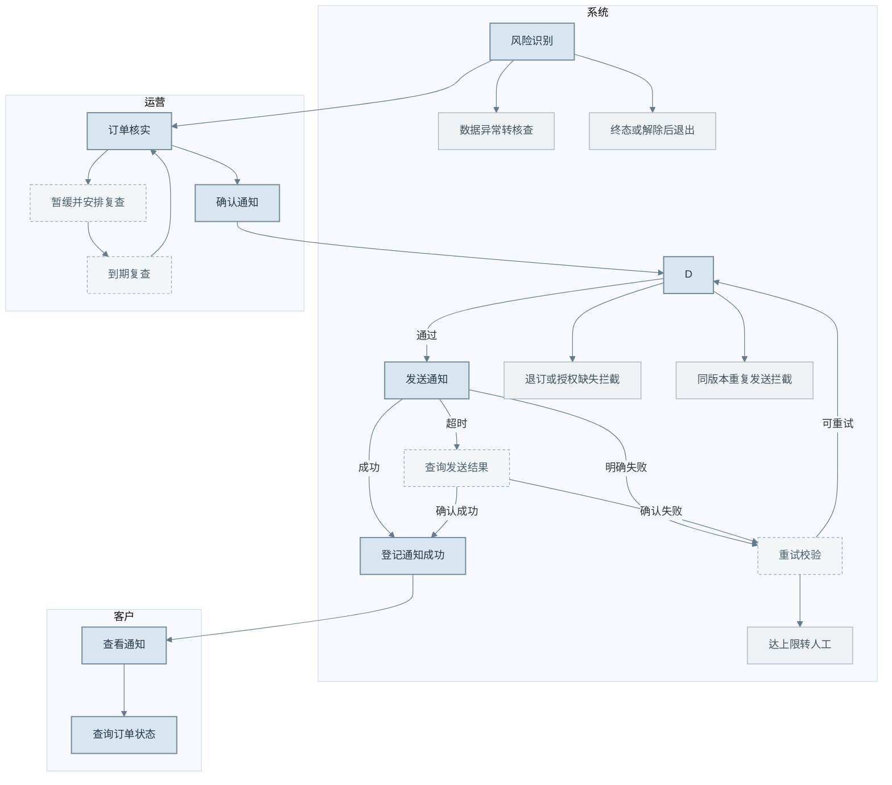
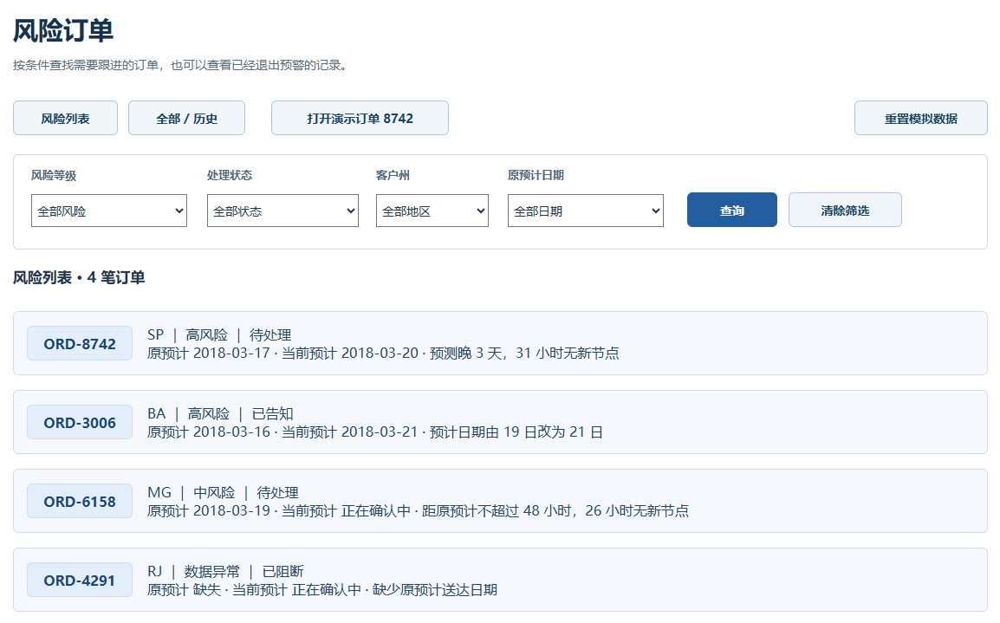
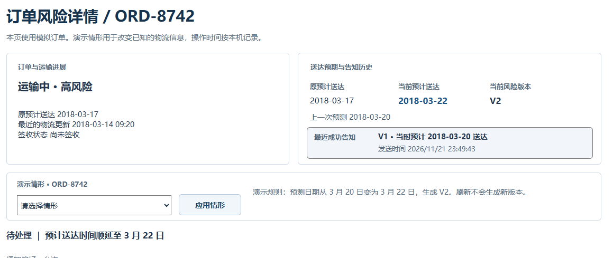
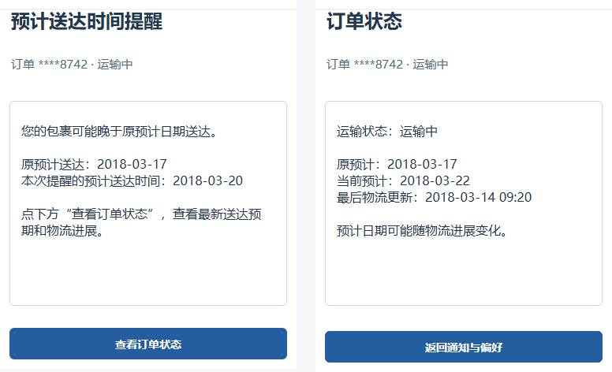

# 订单延迟风险预警与客户通知需求文档

**Olist 履约运营｜模拟方案**　[项目首页](README.md) · [模拟原型验证摘要](#模拟原型验证摘要)

## 1. 背景与目标

在 99,441 笔订单中，96,470 笔满足有效履约条件，其中 6,534 笔逾期（6.77%）。有评价的有效订单中，逾期组与准时组的低评分率分别为 62.36% 和 9.26%；仅保留收货后评价，两组分别为 19.42% 和 9.24%。本期目标是让运营在送达前识别风险、核实并通知客户，客户可查询最新预计送达日期。降低物流咨询量属于后续效果验证目标。[订单分析][analysis] · [Power BI 看板][bi-pdf]

## 2. 需求范围与边界

| 业务模块 | 优先级与核心能力 | 原型页面 |
|---|---|---|
| 风险订单管理 | **P0** 自动判级、退出预警，展示原因、订单详情、物流轨迹及退出记录。**P1** 按风险等级、处理状态等条件筛选和清除筛选。 | OPS-01、OPS-02 |
| 运营端通知处理 | **P0** 预览通知、发送前校验、去重、发送登记、暂缓及复查。**P1** 查询发送结果及重试。 | OPS-02、OPS-03 |
| 客户端通知查询 | **P0** 查看本人订单通知、查询状态、按订单退订。**P1** 对比原预计与最新预计送达日期。 | CUS-01、CUS-02 |
| 规则与模板查阅 | **P2** 运营只读查阅风险分级、退出条件、通知去重规则及通知模板。 | OPS-04 |

| 范围外类别 | 排除项及原因 |
|---|---|
| 业务能力类 | 客服工单、投诉、退款赔付、优惠券、改址及卖家／承运商工作台属于售后或其他角色的处置流程。 |
| 系统接入类 | 真实物流、送达预测、消息渠道、批量推送及预测模型训练涉及外部服务，本期用模拟数据验证单笔订单。 |
| 后台配置类 | 账号登录、完整授权、在线修改阈值和模板、发布审批涉及平台管理，本期采用预设规则与角色。 |
| 效果验证类 | 生产部署、真实 A/B 试验和效果评估需要线上流量及客服咨询记录。 |

## 3. 角色与数据权限

| 业务模块 | 运营 | 客户 | 客服 |
|---|---|---|---|
| 风险订单管理 | 可操作 | 无权限 | 无权限 |
| 运营端通知处理 | 可操作 | 无权限 | 无权限 |
| 客户端通知查询 | 无权限 | 可操作 | 无权限 |
| 规则与模板查阅 | 可查看 | 无权限 | 无权限 |

运营在工作台查看风险队列、物流轨迹及通知历史。客户仅可查本人订单、查看脱敏编号及修改该单通知偏好。系统自动判级和写入日志。客服无独立入口。

## 4. 核心业务流程

## 5. 功能与业务规则

### 5.1 风险判定

按下表顺序取首个匹配结果。异常处理规则详见第6章。

| 顺序 | 判定条件 | 结果 | 备注 |
|---|---|---|---|
| 1 | 命中第6章的数据完整性或状态一致性校验阻断条件 | 转人工核查 | 优先于终态判断。 关键校验：原预计送达日期是否缺失、订单状态与物流轨迹是否冲突。详见[第6章](#6-异常处理与恢复)。 |
| 2 | 订单与物流一致确认已签收、已取消或已关闭 | 退出预警 | 关闭任务与历史记录按第6章处理。 |
| 3 | 履约中，最新预计送达日期晚于原预计日期，或超过原预计送达日仍未送达 | **高风险** | 使用订单当地时间，仅有日期时以该日结束为截止。 |
| 4 | 距原预计截止时间 ≤48 小时，且连续 ≥24 小时无新物流节点 | **中风险** | 两个边界均含等号。 |
| 5 | 自当前履约阶段起点至识别时刻，耗时严格超过该阶段 P90 | **中风险** | 下单至审批 **1.44 天**、审批至交承运商 **6.02 天**、交承运商至签收 **18.90 天**。展示保留两位；判定取[非负耗时统计][stages]的原始精度。缺阶段起点时跳过本项。 |
| 6 | 有效履约订单均未命中以上条件 | **正常** | 原有预警解除，保留历史。 |

### 5.2 运营端通知处理

| 业务规则 | 执行条件与结果 |
|---|---|
| 发送前校验 | 运营确认发送时，系统重新读取订单、物流轨迹、风险等级、客户偏好及通知历史。仅中／高风险且通过校验的订单可提交。 关键校验：订单与物流信息、客户授权与退订状态、同一风险版本是否已有同类成功通知。详见[第6章](#6-异常处理与恢复)。 |
| 风险版本 | 首次识别风险记 V1。风险依据实质变化（最新预测日期、物流状态或风险等级变更）时，版本递增、处理状态恢复为待处理，发送尝试次数重新计数；仅常规物流节点更新、日期相同、页面刷新或重复扫描沿用原版本。 |
| 成功登记 | 收到成功的发送结果回调，或查询确认成功后，记录通知版本、发送时的预测日期和成功时间，标记「已通知」。履约风险独立判定。 |
| 暂缓与复查 | 暂缓原因、复查时间均必填。保存后标记「已暂缓」并生成任务，复查时重新核实订单。暂缓操作不产生通知。 |
| 操作记录 | 按订单记录发送、失败、重试、暂缓和退出事件的执行人、时间、动作、结果与原因。退出后历史仍可查。 |

#### 运营端原型截图

**图 1 · 风险订单列表**

**图 2 · 订单风险详情**

**图 3 · 同版本重复通知拦截**

暂缓必填校验、发送结果查询等更多异常场景演示，详见[第7章验收用例](#7-验收标准)与[原型走查说明](#模拟原型验证摘要)。

### 5.3 客户端通知查询

| 业务规则 | 客户可见结果 |
|---|---|
| 通知内容 | 展示订单尾号及最近成功通知时的预计送达日期。后续预测变动保留该条通知原文。 |
| 订单查询 | 从通知进入同一订单，显示运输状态、原预计日期、最新预计日期和最后物流更新时间。 |
| 通知偏好 | 按「订单＋提醒类型」退订。各订单分别保存偏好。发送拦截见第6章。 |

#### 客户端原型截图

**图 4 · 已发通知与最新订单状态对照**

左侧为已发通知，保留 3 月 20 日。右侧为订单状态，显示最新的 3 月 22 日。

## 6. 异常处理与恢复

| 分类 | 触发条件 | 系统处理与恢复 |
|---|---|---|
| 数据类异常 | 原预计日期缺失，或订单状态与物流轨迹冲突 | 标记数据异常，阻断通知并说明原因。运营核实后重新判定；信息矛盾时不得按签收退出。 |
| 数据类异常 | 仅缺最新预测 | 继续按其他已知条件判级。可发送风险提醒，客户端显示「正在确认中」。 |
| 业务类异常 | 已退订或客户授权信息缺失 | 已退订则阻断本单同类通知，每个新版本均须校验；授权信息缺失则暂停并核实。订单风险继续跟进。 |
| 业务类异常 | 同一订单、同一风险版本、同一提醒类型已有成功记录 | 阻断重发，展示上次成功时间，保留唯一成功记录。 |
| 业务类异常 | 已一致确认终态，或已无风险依据 | 退出预警，停止本次通知，取消未完成复查并记录退出原因。 |
| 业务类异常 | 暂缓原因或复查时间漏填 | 提示缺失项，保留原处理状态，不创建复查任务。 |
| 发送类异常 | 通知服务明确返回失败 | 记录「发送失败」。同一订单每个风险版本最多提交 **3 次（含首次）**。有剩余次数时重新执行发送前校验，用尽则转人工。 |
| 发送类异常 | 超时且结果未知 | 标记「待核实」，暂停重发。查询到成功则登记并阻止重复发送，确认失败走重试流程，仍未知则继续待核实。 |

## 7. 验收标准

### 主流程用例

| 用例编号 | 前置条件 | 操作步骤 | 预期结果 |
|---|---|---|---|
| AC-P1 | 8742 为高风险，V1 未通知，允许接收 | 确认发送并返回成功 | 进入成功页，详情可查 V1、预测日期及成功时间。 |
| AC-P2 | 风险订单待处理 | 填写原因和复查时间，提交暂缓，再恢复处理 | 详情回显所填内容；可恢复处理，暂缓操作不产生成功通知。 |
| AC-P3 | V1 已通知 3/20，最新预测改为 3/22 | 从客户通知进入订单状态 | 通知原文保留 3/20，状态页显示 3/22。 |

### 异常场景用例

| 用例编号 | 前置条件 | 操作步骤 | 预期结果 |
|---|---|---|---|
| AC-E01 | 4291 缺原预计日期 | 尝试发送 | 阻断发送并提示缺失字段。 |
| AC-E02 | 订单与物流均确认签收 | 重新识别，再查历史 | 退出队列，历史记录可查签收原因。 |
| AC-E03 | 两笔订单分别已取消、已关闭 | 分别识别并尝试发送 | 均退出预警且阻断通知，分别保留取消、关闭原因。 |
| AC-E04 | 可通知订单，无成功记录 | 分别模拟明确失败及超时；超时后查询成功、失败、未知三种结果 | 明确失败可在限额内复核重试，保留原失败记录。查询成功后阻止重发，失败可重试，未知维持待核实。 |
| AC-E05 | 同单同类 V1 通知已成功 | 再次发送 | 阻断重复发送，展示上次成功时间，成功记录仍为一条。 |
| AC-E06 | 8742 已发送 V1，预测为 3/20 | 改为 3/22，刷新，再发送 V2 两次 | 版本仅递增一次；首次成功后，第二次被拦截。 |
| AC-E07 | A、B 两单均允许接收且尚未发送 | 客户退订 A 单，再分别校验 A、B | A 单拦截且风险仍可跟进，B 单偏好仍为允许。 |
| AC-E08 | 6158 有风险依据，当前预测为空 | 打开订单状态 | 原预计日期可查，最新预计显示「正在确认中」。 |
| AC-E09 | 订单显示已送达，物流仍在运输 | 尝试通知 | 提示状态冲突，转人工核查，保留预警记录。 |
| AC-E10 | 已暂缓且有复查任务 | 将订单切换为风险解除 | 退出队列并取消复查，历史保留暂缓及退出记录。 |

### 边界校验用例

| 用例编号 | 前置条件 | 操作步骤 | 预期结果 |
|---|---|---|---|
| BA-01 | 客服或客户身份 | 尝试执行运营发送动作 | 拒绝操作，订单状态及成功通知数均不变。 |
| BA-02 | 风险订单待处理 | 分别漏填原因、复查时间并提交 | 提示对应必填项，两次均不创建复查任务。 |
| BA-03 | 初始 4 单 | 筛选高风险，叠加待处理，再清除；切换 8742 正常／晚到 | 列表依次为 8742 和 3006、仅 8742、全部 4 单；切换后随风险移出／进入队列。 |
| BA-04 | 有效在途，预测按期，阶段未超时 | 分别输入距到期 48 小时且 24 小时无更新、距到期 12 小时且 1 小时前有更新，再将首单预测改为晚到 | 依次为中风险、正常、高风险。 |

### 模拟原型验证摘要

以下结果来自本地 HTML 原型的走查。

| 场景 | 已观察到的结果 |
| --- | --- |
| 发送通知与客户查询（AC-P1、AC-P3） | 发送成功后登记预计日期。预测更新至 3 月 22 日后，已发通知仍显示 3 月 20 日，订单状态页显示 3 月 22 日。 |
| 暂缓与复查（AC-P2、BA-02） | 暂缓原因或复查时间漏填时提示补齐。填齐后详情显示所填内容，可恢复处理。 |
| 发送失败与超时（AC-E04） | 明确失败可重试，失败事件保留。超时先查询发送结果，确认失败才可重试，仍未知则保持待核实。 |
| 版本去重与退订（AC-E05～AC-E07） | 同版本重复发送被拦截。预测变化后可校验并发送新版本。退订拦截该订单的后续提醒。 |

签收退出和状态冲突也已走查。取消或关闭订单、暂缓后风险解除、服务端岗位鉴权及分级边界仍列为后续验证项。

## 8. 数据与系统约束

| 字段 | 类型与格式 | 取值与使用口径 |
|---|---|---|
| 订单编号 | 字符串，沿用订单系统唯一标识 | 非空，关联物流、风险及通知记录。原型示例 ORD-8742，客户端仅展示后四位。 |
| 订单状态 | 枚举字符串 | 本流程区分履约中（含待发运、已交承运商、运输中）、已签收、已取消、已关闭。终态以订单和物流一致为准。 |
| 原预计／最新预计／已通知预计送达日期 | 日期，YYYY-MM-DD，按订单当地日历 | 原预计为判定基准；最新预计可空；已通知预计取成功发送时的快照，可以为空，后续更新不覆盖。 |
| 物流节点／成功发送／复查时间 | 日期时间，YYYY-MM-DD HH:mm:ss，传输时携带时区 | 分别取最近物流事件时间、确认成功的发送时间、运营约定复查时间。无成功记录时成功时间为空，暂缓时复查时间必填。 |
| 风险等级／预警标记 | 枚举字符串 | 等级为正常、中风险、高风险。数据异常和已退出作为预警标记单独展示。 |
| 风险版本 | 正整数，界面显示 V1、V2… | 从 1 起，按订单递增；版本变化条件见 §5.2。 |
| 处理状态 | 枚举字符串 | 待处理、已暂缓、已通知、发送失败、待核实、已阻断、转人工、无需通知、已退出。与风险等级独立。 |
| 通知偏好 | 枚举字符串，按订单及提醒类型保存 | 允许、已退订；缺少授权信息按第6章处理。 |
| 发送结果／尝试次数 | 结果为枚举，次数为整数 | 每次尝试的结果为成功、失败或未知。每订单每版本累计 0～3 次；结果回调关联原发送尝试。 |

风险判定只使用识别时已知的信息。系统按订单归属限制访问，按订单保留运营与通知历史；生产接入需验证并发去重、延迟回调及跨会话记录留存。

[analysis]: data-analysis/tables/late-delivery-and-ratings.csv
[bi-pdf]: data-analysis/olist-delivery-dashboard.pdf
[stages]: data-analysis/tables/fulfillment-stage-duration.csv
